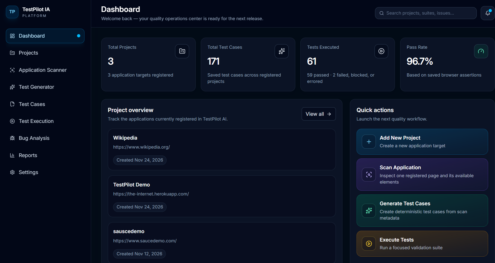
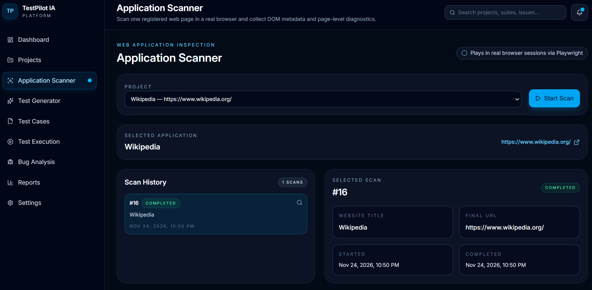
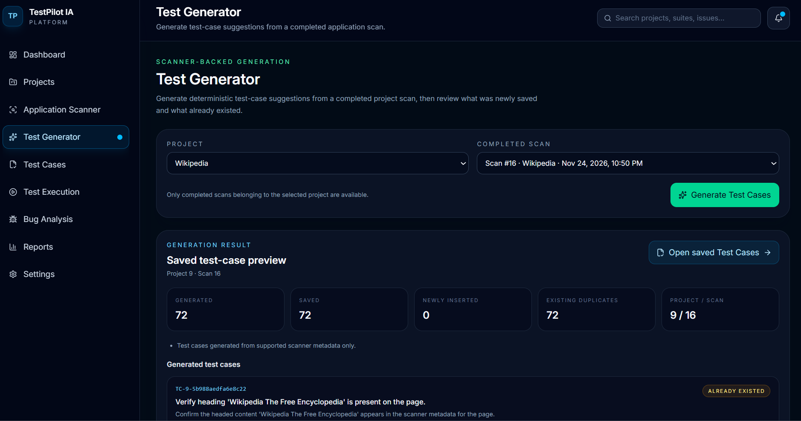
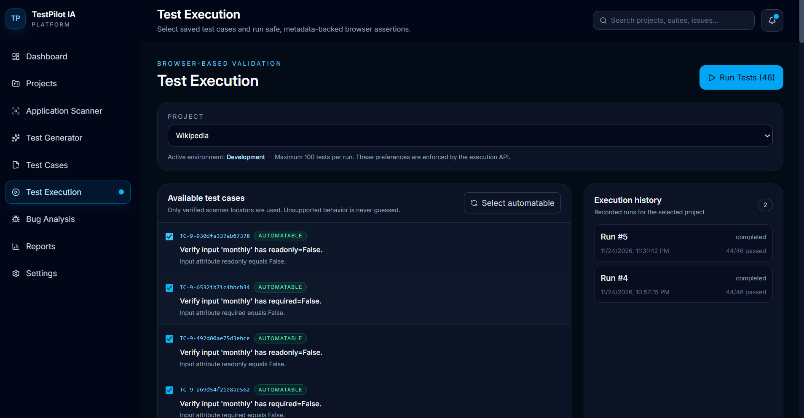
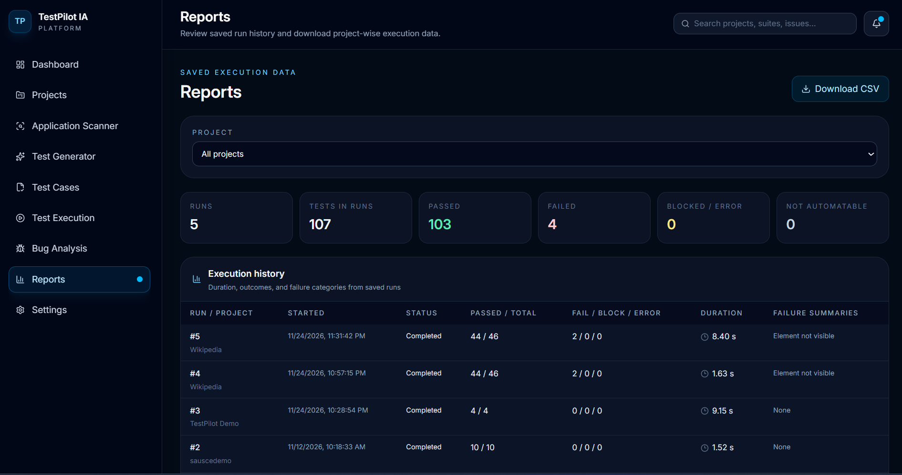

<div align="center">

# 🚀 TestPilot AI

### AI-Assisted Web Testing & Quality Assurance Platform

**Scan · Generate · Execute · Analyze · Report**

A browser-based testing platform that brings application scanning, structured test generation, automated browser assertions, failure analysis, and reporting into one workspace.

<br/>

<a href="https://test-pilot-ai-nine.vercel.app/">
  
</a>
<a href="https://testpilot-ai-backend-fg0p.onrender.com/docs">
  
</a>

<br/><br/>


</div>

---

## 🌐 Live Application

| Resource | Link |
|---|---|
| **Live Demo** | [Launch TestPilot AI](https://test-pilot-ai-nine.vercel.app/) |
| Backend API | [Render Backend](https://testpilot-ai-backend-fg0p.onrender.com) |
| API Documentation | [Swagger UI](https://testpilot-ai-backend-fg0p.onrender.com/docs) |
| Source Code | [GitHub Repository](https://github.com/Sumanth-308/TestPilot-AI) |

> **Demo information:** The frontend is hosted on Vercel and the backend runs on Render's free tier. The backend may take a short time to wake up after inactivity. If the dashboard displays **Backend Not Connected**, wait briefly and refresh. If the issue persists, the frontend-backend configuration needs to be checked. SQLite data may reset because the hosting environment uses an ephemeral filesystem. Avoid entering confidential information.

---

## 📌 Overview

TestPilot AI is a web-based application testing platform designed to organize and simplify web quality assurance workflows.

It uses **Playwright** to inspect loaded web pages, discover interactive elements, and execute supported browser assertions. Discovered page metadata is used to generate structured test cases that can be managed, executed, analyzed, and included in downloadable reports.

The platform provides a centralized workspace for managing the testing lifecycle.

## ✨ Key Features

| Module | Description |
|---|---|
| 📊 Dashboard | View project activity and testing metrics. |
| 📁 Project Management | Register and manage web applications. |
| 🔍 Application Scanner | Inspect loaded web pages and discover interactive elements using Playwright. |
| 🧪 Test Generator | Generate deterministic test cases from scanner metadata. |
| 📋 Test Cases | Browse, filter, inspect, and manually update saved test cases. |
| ▶️ Test Execution | Execute supported browser assertions in isolated Chromium contexts. |
| 🐞 Bug Analysis | Review execution failures and diagnostic information. |
| 📑 Reports | Review run summaries and download detailed reports. |
| ⚙️ Settings | Configure workspace preferences and available quality-gate settings. |

---

## 🔄 Application Workflow

```text
                  ┌─────────────────────┐
                  │   Create Project    │
                  └──────────┬──────────┘
                             ▼
                  ┌─────────────────────┐
                  │ Register Website URL│
                  └──────────┬──────────┘
                             ▼
                  ┌─────────────────────┐
                  │ Application Scanner │
                  │      Playwright     │
                  └──────────┬──────────┘
                             ▼
                  ┌─────────────────────┐
                  │ Discover Interactive│
                  │      Elements       │
                  └──────────┬──────────┘
                             ▼
                  ┌─────────────────────┐
                  │   Test Generator    │
                  │  Scanner Metadata   │
                  └──────────┬──────────┘
                             ▼
                  ┌─────────────────────┐
                  │    Test Execution   │
                  │      Chromium       │
                  └──────────┬──────────┘
                             ▼
                  ┌─────────────────────┐
                  │   Bug Analysis      │
                  └──────────┬──────────┘
                             ▼
                  ┌─────────────────────┐
                  │  Reports & History  │
                  └─────────────────────┘
```

---

## 🖥️ Application Preview

### Dashboard




### Project Management


### Application Scanner



### Test Generation & Management




### Test Execution


### Bug Analysis



### Reports


### Workspace Settings



---

## 🏗️ System Architecture

TestPilot AI follows a frontend-backend architecture connected through REST APIs.

```text
┌────────────────────────────────────────────┐
│                 FRONTEND                   │
│                                            │
│             React + TypeScript             │
│                   Vite                     │
│                                            │
│ Dashboard | Projects | Scanner              │
│ Generator | Execution | Reports             │
└─────────────────────┬──────────────────────┘
                      │ REST API
                      ▼
┌────────────────────────────────────────────┐
│                  BACKEND                   │
│                                            │
│                  FastAPI                   │
│                                            │
│ Project Management                         │
│ Application Scanning                       │
│ Test Generation                            │
│ Test Execution                             │
│ Bug Analysis & Reporting                   │
└──────────────┬──────────────────┬──────────┘
               │                  │
               ▼                  ▼
      ┌────────────────┐  ┌────────────────┐
      │   Playwright   │  │    SQLite      │
      │    Chromium    │  │    Database    │
      └────────────────┘  └────────────────┘
```

## 🛠️ Technology Stack

| Layer | Technologies |
|---|---|
| Frontend | React, TypeScript, Vite |
| Styling | Tailwind CSS |
| Backend | Python, FastAPI |
| Browser Automation | Playwright, Chromium |
| Database | SQLite |
| Backend Testing | Pytest |
| Frontend Testing | Vitest |
| Deployment | Vercel, Render |
| Containerization | Docker |

---

## ⚙️ Local Setup

### Prerequisites

- Python 3.12+
- Node.js and npm
- Git
- Chromium support through Playwright

### 1. Clone the Repository

```bash
git clone https://github.com/Sumanth-308/TestPilot-AI.git
cd TestPilot-AI
```

### 2. Backend Setup

From the repository root:

```powershell
python -m venv .venv
.venv\Scripts\Activate.ps1

pip install -r backend\requirements.txt
playwright install chromium
```

Start the backend using the command configured for your project:

```bash
uvicorn backend.main:app --reload --port 8001
```

Backend: `http://127.0.0.1:8001`

API documentation: `http://127.0.0.1:8001/docs`

### 3. Frontend Setup

Open a separate terminal:

```bash
cd frontend
npm install
```

Create or update the frontend `.env` file:

```env
VITE_API_BASE_URL=http://127.0.0.1:8001
```

Start the frontend:

```bash
npm run dev
```

Open the local URL displayed by Vite.

---

## 🧪 Testing

The project includes automated backend and frontend tests.

| Test Suite | Last Recorded Result |
|---|---:|
| Backend | 76 passed |
| Frontend | 18 passed |
| **Total** | **94 passed** |

*These are previously recorded results; rerun the test suites to confirm the current state.*

---

## 🔐 Security & Validation

The application includes safeguards for its scanning workflow:

- HTTP/HTTPS URL validation.
- Localhost and private-network destination restrictions.
- DNS and public-IP validation.
- Browser request route checks.
- Backend input validation using Pydantic.

> **Deployment note:** The public demo is intended for evaluation and portfolio demonstration, not production use. It currently lacks user authentication and API rate limiting. Do not submit confidential URLs, credentials, or sensitive application data.

---

## ⚠️ Current Limitations

- Test generation is deterministic and metadata-based; it is not currently powered by an LLM.
- Scanning focuses on the loaded page rather than autonomous multi-page exploration.
- Execution supports implemented operations and assertions, not arbitrary workflows.
- Chromium is currently supported.
- SQLite demo data may reset because of the hosting environment's ephemeral filesystem.
- The public demo does not currently include authentication or rate limiting.

---

## 🗺️ Future Enhancements

- [ ] LLM-powered test generation.
- [ ] Multi-page crawling and deeper application exploration.
- [ ] Expanded browser and cross-browser support.
- [ ] More advanced test assertions and workflow execution.
- [ ] Persistent cloud database.
- [ ] User authentication and role-based access.
- [ ] Enhanced reporting and test analytics.

---

## ☁️ Deployment

| Component | Platform |
|---|---|
| Frontend | Vercel |
| Backend | Render |
| Backend Runtime | Docker |
| Database | SQLite |

**Deployment links**

- [Live Application](https://test-pilot-ai-nine.vercel.app/)
- [Backend API](https://testpilot-ai-backend-fg0p.onrender.com)
- [API Documentation](https://testpilot-ai-backend-fg0p.onrender.com/docs)

---

## 📄 License

This project is licensed under the **MIT License**. See [LICENSE](LICENSE) for details.

---

## 👨‍💻 Author

**Guthi Sumanth**

B.Tech Computer Science & Engineering (Cybersecurity)

- GitHub: [Sumanth-308](https://github.com/Sumanth-308)
- LinkedIn: [Sumanth Guthi](https://www.linkedin.com/in/sumanthguthi/)

---

<div align="center">

### TestPilot AI

**Making Web Testing More Accessible.**

Built with a focus on browser automation, software quality, and practical engineering.

</div>