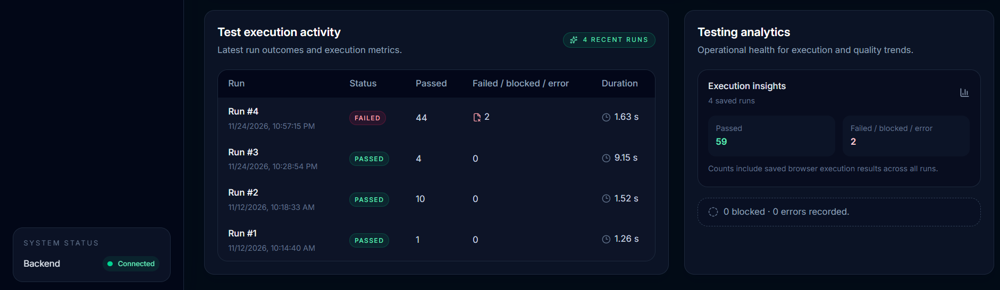
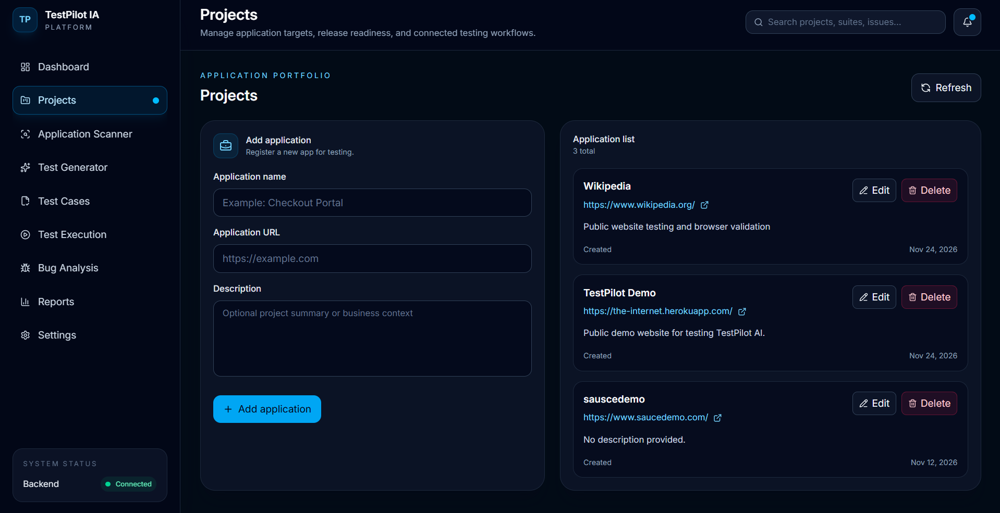
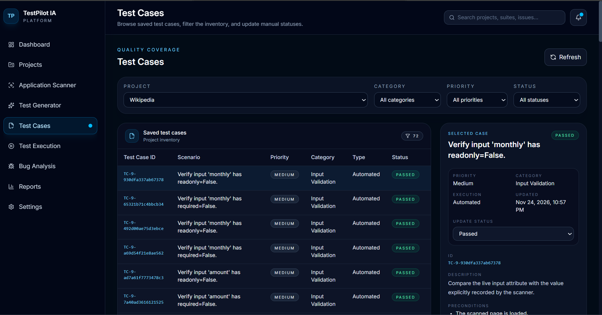
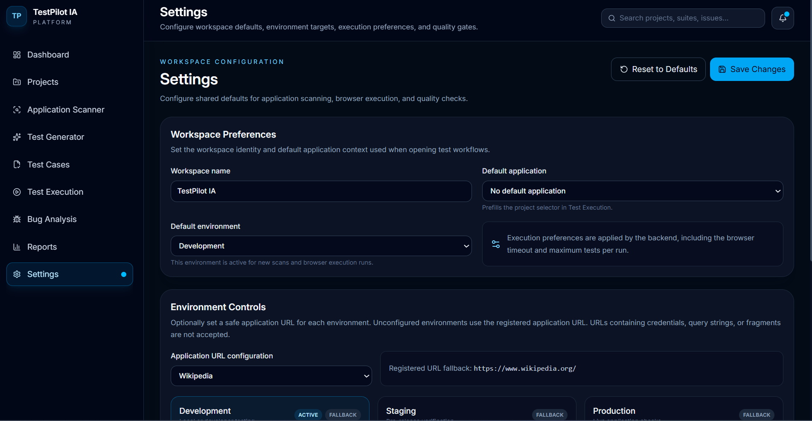
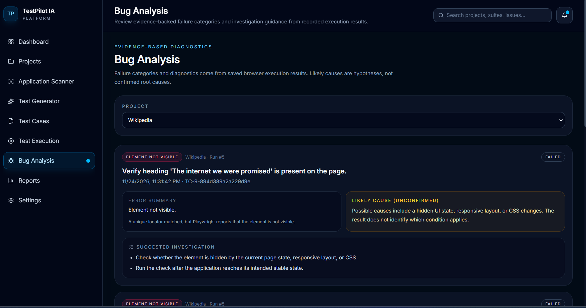

# TestPilot AI

TestPilot AI scans registered web applications, generates saved test cases from scanner metadata, executes supported assertions in isolated Playwright Chromium contexts, and stores run history for analysis and CSV reporting.

## Requirements

- Python 3.12
- Node.js 20.19+ (Node.js 24 recommended)
- npm
- Windows PowerShell for the commands below

## Install

From `E:\Projects\TestPilot-AI`:

```powershell
.\.venv\Scripts\python.exe -m pip install -r backend\requirements.txt
.\.venv\Scripts\python.exe -m playwright install chromium
Set-Location frontend
npm ci
```

## Run the application

Start the backend in one terminal from the repository root:

```powershell
.\.venv\Scripts\python.exe -m uvicorn backend.main:app --host 127.0.0.1 --port 8001
```

Start the frontend in a second terminal:

```powershell
Set-Location frontend
npm run dev -- --host 127.0.0.1
```

Open `http://localhost:5173`. The backend API is at `http://127.0.0.1:8001`; interactive API documentation is at `http://127.0.0.1:8001/docs`.

The SQLite database is `backend\data\testpilot.db`. Schema initialization adds workspace settings and execution quality-gate columns without recreating tables or deleting existing records. Test-case IDs remain globally unique; new IDs are scoped to their project during persistence, while existing IDs are retained.

## Typical workflow

1. Register an application in **Projects**.
2. Scan it in **Application Scanner**.
3. Use **Test Generator** to select the project and one of its completed scans, then generate deterministic test cases from scanner metadata. The separate **Test Cases** page lists saved cases, filters the inventory, shows full details, and updates manual status.
4. Review the automation eligibility shown in **Test Execution**.
5. Select cases and run browser assertions.
6. Review saved results in execution history, **Bug Analysis**, and **Reports**.
7. Configure the workspace name, default project/environment, safe environment URL overrides, execution limits, and quality gate thresholds in **Settings**.
8. Download a CSV report from **Reports**.

Settings are stored in SQLite and exposed through `GET /api/settings`, `PUT /api/settings`, and `POST /api/settings/reset`. Environment URL overrides are project-scoped and apply to new scans and browser runs; an unset override falls back to the registered application URL. URLs containing credentials, query strings, or fragments are rejected, and the scanner/executor continue to apply their destination protections. Execution timeout and maximum tests-per-run settings are enforced by the browser execution API. Each run stores its environment and evaluates a quality gate using the configured pass-rate and failure thresholds.

The scanner inspects one loaded page; it does not crawl site-wide routes. Execution supports visible heading and button checks, scanned link `href` and destination-class verification, button enabled-state checks, and explicit input-attribute checks. Every locator must have a unique measured scanner candidate and must still match exactly one live element. The runner does not click controls, fill fields, submit forms, execute page-provided JavaScript, or invent behavior.

The CSV report preserves run summaries and includes one detail row for each saved test-case result, with expected/actual values and failure diagnostics where available.

## Validation

Run backend tests and syntax checks from the repository root:

```powershell
.\.venv\Scripts\python.exe -m pytest -q
.\.venv\Scripts\python.exe -m compileall backend
```

Run frontend tests, lint, and production build from `frontend`:

```powershell
npm test
npm run lint
npm run build
```

## MVP limitations

- Behavior-dependent cases (including login, form submission, and workflows) remain **Not Automatable** until explicit safe assertions are available.
- Test cases are generated deterministically from scan metadata; the current generator does not call an AI model.
- Older scans without structured, verified locator metadata can be blocked from execution; run a fresh scan to collect it.
- Only Chromium is used, and a run opens the registered application URL once without performing state-changing interactions.
- Screenshot capture is intentionally disabled to avoid storing potentially sensitive page content; `screenshot_path` is therefore null.
- Private, local, and otherwise unsafe destinations remain blocked by the scanner's existing URL protections.

## Screenshots

### Dashboard



### Project Management


### Application Scanning


### Test Generation and Management



### Test Execution


### Bug Analysis


### Reports


### Workspace Settings

